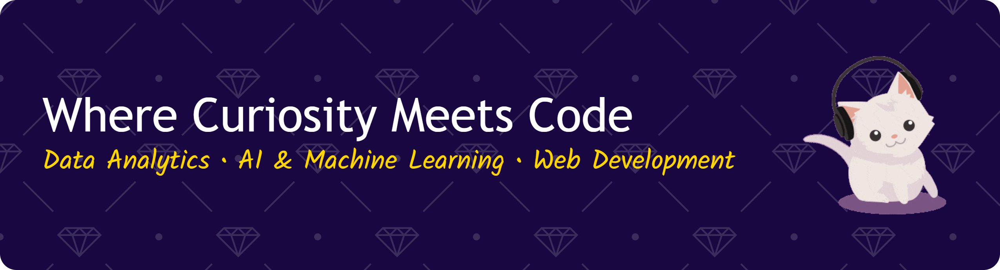

# Hi, I'm Qonita Nashifa!👋 
   
#### 🌸 Skills

  
  
  
  
  
  
  
  
  
  
  
  
  
  
  
  
  

#### 💌 Connect With Me 
  

#### 🎀 GitHub Analytics

#### 🎮 Play a Game With Me!!!
<picture data-importer="pacman">
  <source media="(prefers-color-scheme: dark)" srcset="https://raw.githubusercontent.com/QonitaBila/QonitaBila/pacman-output/pacman-contribution-graph-dark.svg?game=pacman">
  <source media="(prefers-color-scheme: light)" srcset="https://raw.githubusercontent.com/QonitaBila/QonitaBila/pacman-output/pacman-contribution-graph.svg?game=pacman">
  
</picture>
